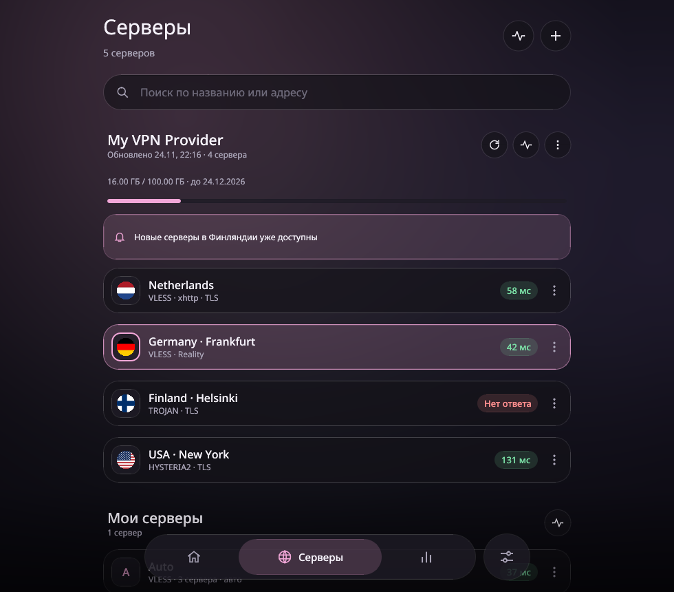
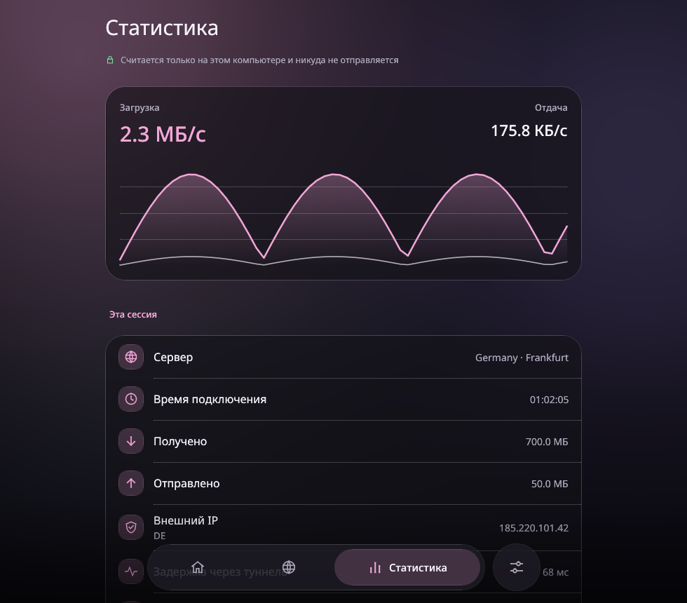
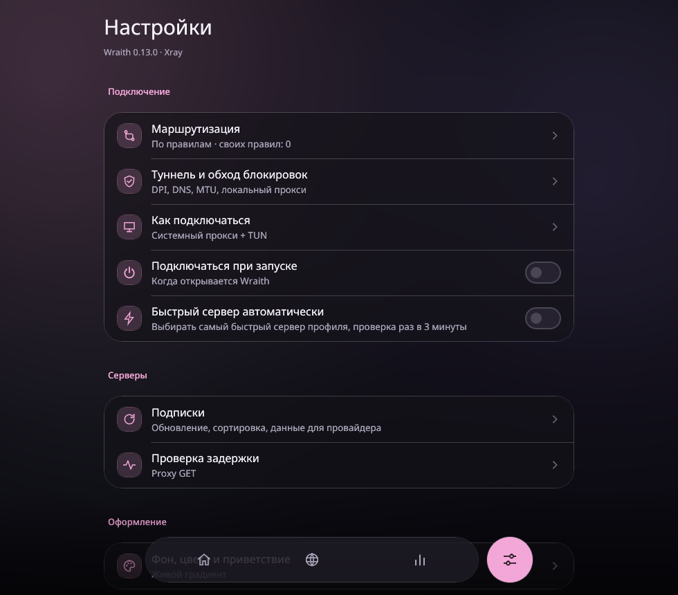

# Wraith for Linux

Native Linux VPN client in Rust (egui) for VLESS / VMess / Trojan / Shadowsocks / Hysteria2 / WireGuard on **Xray-core**. This is the Linux edition of Wraith for Windows and [Wraith for Android](https://github.com/trinity13338/Wraith-android).

> Русский: Wraith для Linux — нативный клиент на Rust на ядре Xray. Он понимает подписки (с заголовками Happ), JSON Xray и авто-конфиги с балансировщиками. Язык интерфейса — русский или английский, по локали системы. Работает в режимах системного прокси (KDE / GNOME) и TUN, на Wayland и X11. С версии 0.13 интерфейс и возможности перенесены из Wraith для Android: живой фон или своё фото, акцентные цвета, приветствие, внешний IP и задержка через туннель, статистика по дням, которая никуда не отправляется.

<p>




</p>

## Download

From the [releases](https://github.com/trinity13338/Wraith-linux/releases/latest):

- **`wraith-setup-*-x64`** — the installer (`chmod +x` and run it as your user).
  - Installs into `/opt/wraith`, owned by root, so nothing you run can swap the core.
  - Gives the bundled Xray core the `cap_net_admin,cap_net_raw` file capabilities once, which TUN needs. Wraith itself always runs as your user, without root.
  - Adds Wraith to the application menu and, if you choose, to autostart and the desktop.
  - Uninstall: «Uninstall Wraith» in the menu entry's actions, or `wraith --uninstall`.
- **`Wraith-Linux-*-x64.zip`** — the portable build. Unpack it and run `./wraith`. The first TUN connection asks for the administrator password once (polkit) to give `xray` its capabilities.

## Features

- **The Android app's interface (0.13).**
  - Your own photo as the background (blur and dimming), or a live gradient that reacts to the connection.
  - Accent colours: presets, the colour of your photo, or the desktop's accent (KDE / GNOME).
  - A greeting, live stats in a fixed grid (time, exit IP, delay through the tunnel, speed), a connect button with packets running through it at the speed of the traffic, and a floating tab bar: Home, Servers, Statistics, Settings.
- **Statistics that stay on the computer.** Live speed chart, this session, and daily totals for the last 14 days in `traffic.json`. Nothing is uploaded.
- **Servers.** Flags, latency chips, favourites, subscription usage and expiry notices; edit a server's link or JSON, see the Xray config, run diagnostics (the core checks the config).
- **Backup.** Export servers, subscriptions, rules and settings to a JSON file and restore them.
- **Import.** Share links, HTTPS subscriptions with Happ headers (usage, expiry, announce, routing profile), and full Xray JSON, including multi-server configs with balancers (`leastPing` + `observatory`).
- **Russian or English** interface, picked from the session locale (`LANG`, or `WRAITH_LANG=ru|en`).
- **System proxy and TUN** as independent switches; both are on by default.
  - System proxy: KDE Plasma (`kioslaverc`) and GNOME and its relatives (`gsettings`). The previous setting is saved and restored after a disconnect, a crash or a logout.
  - TUN: the `wraith0` interface. Xray adds the routes itself and binds its own connections to the physical interface. Routing rules can match programs.
- **Latency checks through the proxy.**
  - Every server of an auto config is checked, and the best result counts.
  - Keep-alive mode measures the server round trip without the handshake.
  - TCP and ICMP checks are available too.
- **DNS** is the system's by default (systemd-resolved is understood). The provider's DNS from JSON and your own DoH/DoT address are opt-in. IP addresses: Auto / IPv4 / IPv6. QUIC (UDP 443) can be blocked so browsers fall back to TCP.
- **Subscriptions** update in the background once their interval has passed (checked hourly), on start if you like, and can be pinged on start.
- **Desktop.** Tray icon (StatusNotifierItem: KDE, GNOME with the AppIndicator extension, XFCE, …), autostart, closing to the tray (also on Wayland). File dialogs for the photo and backups use kdialog or zenity.
- **Security.**
  - Settings are encrypted (ChaCha20-Poly1305) with a key that only your user can read (`~/.local/share/wraith`, mode 0700).
  - The Xray config is passed through stdin, so no config file can be swapped while the core runs with network capabilities.
  - Updates come from GitHub Releases. They are verified by SHA-256 and unpacked in memory.
  - Imported configs cannot open their own API listeners or services, and cannot write log or cache files.
  - The local proxy is reachable from the LAN only with a password.

## Building

You need Rust stable and the usual desktop libraries (`dbus`, `libxkbcommon`, `wayland`, OpenGL; on Arch they come with any desktop).

```sh
cargo build --release
```

Put `xray`, `geoip.dat` and `geosite.dat` from the [Xray-core release](https://github.com/XTLS/Xray-core/releases) next to `target/release/wraith`. Without them Wraith uses a distribution package (`/usr/bin/xray` with `/usr/share/xray`).

The whole release (zip and installer) is built by `./package.sh`: it downloads Xray, checks its SHA-256, packs the archive and builds the installer with it embedded (`WRAITH_PAYLOAD=… cargo build --release --features setup`).

Tests: `cargo test`. `WRAITH_SHOTS=dir cargo test --release -- --ignored --test-threads=1 render_screens` draws every screen without a window into PNG files (the README screenshots).

The tests validate generated configs with the real core when `WRAITH_TEST_XRAY` points at an `xray` binary (geo files next to it) or one is found in `../.tools/xray-integration/core`. `cargo test -- --ignored` adds end-to-end checks through a local Xray server.

## License

GPL-3.0-or-later (see [LICENSE](LICENSE)). Third-party components: [THIRD_PARTY_NOTICES.md](THIRD_PARTY_NOTICES.md).
